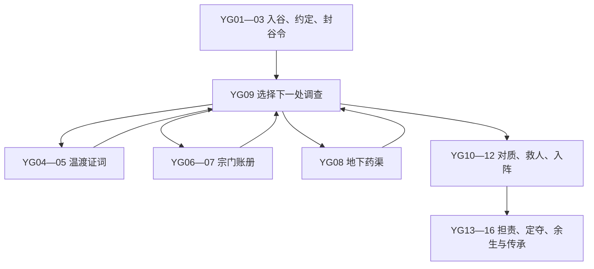

> v3 对话旅程的现行作者约定见 [对话旅程作者稿](dialogue-journey.md)。新章唯一调查限制为最多两条独立路线，不再叠加本文旧八年钟；原稿下文保留作人物与固定真相来源。

> 原始作者稿，作者版本日期2026-10-24；于2026-10-25随1.1.0候选保存。以下保留原稿正文，用作叙事、人物与场景设计依据，不是精确的运行时契约。原稿的建议耗年、成本、状态名称、节奏与范围可能随实现取舍而不同；执行成本和合法选择以 `src/game/story-content.js`、`src/game/story.js`、`engine.getStoryView()` 及 [引擎契约](../ENGINE_CONTRACT.md) 为准。实际验证以 [验收记录](../QA_REPORT.md) 为准。20–30分钟仍是未经真人计时的目标。原稿末尾的工作目录式文档名称为当时写作上下文，其可移植对应为 [升级设计](../superpowers/specs/2026-10-25-narrative-adventure-design.md)。

# 《问鼎》首章内容初稿：药谷旧火

版本：2026-10-24；用途：交给实现者直接拆成原生 JS 场景数据，不要求迁移 Ink。本文只设计内容，没有修改产品代码。

## 最强建议

**把“最后一枚灵种归谁”做成结局抉择，把“旧火到底怎么来的”做成调查主线。真相固定，玩家改变的是能证明多少、谁肯负责、谁付代价。** 初世不是随机抽中药谷后领一次奖励，而是进入一条会主动推进的任务；第二世处理第一世建立的制度或留下的损害。

每个场景保持两到三段连续叙述/对话；点击选项后展示约60–100字的明确结果，再进入下一段。UI顶部常驻“眼下要做的事”“封谷还剩几年”“已知线索/未兑现承诺”。核心剧情不从随机池抽，随机只作用于两次路途中出现哪条旁支。

**16个核心节点是内容总量，单次主线约12个核心节点 + 2个随机旁支 + 3段结局对话；阅读、比较选项与一次短战斗共同承担20–30分钟目标。不要声称文本长度保证时长，首轮真人试玩后调整。** 若实玩仅10分钟，应增加对话与探索反馈，不应加重复修炼次数。

## 一、事实、人物与时钟

### 固定真相

十八年前，归衡宗为赶制救治瘟疫的丹药，连续三季超量抽取药谷地火。地脉已失衡，宗门仍以旧图认定东闸能泄火。掌闸人温渡奉令开闸，沈蘅留在谷内打开药窖救人；火却沿被私改的地下药渠倒灌，烧死药农。归衡宗执行者陆槐随后封谷，压下账册，既为护住当年参与运药的弟子，也为掩盖宗门的判断错误。沈蘅的女儿沈芷只知道母亲被列为“擅启药窖，引火殃众”的罪人。

没有隐藏邪魔替所有人承担责任。救疫是真，超采是真，开闸者听令也确实伤了人。灵种能修复谷地，但需要稳定地脉和持续照料；直接取走会使谷地最终失去生机。现在宗门打算八年后将谷地彻底石封，并收走灵种。封谷之前，玩家必须查明能证实的事实，安排撤离，决定灵种与谷民的未来。

### 三名具名NPC

| ID | 姓名与初见 | 想要/害怕 | 可信改变的条件 |
|---|---|---|---|
| `shen_zhi` | 沈芷，32岁，药谷医者；YG01初见 | 为母亲正名、留下活的药谷；怕玩家拿真相换赏钱 | 救治谷民或保护温渡增加信任；卖交灵种、以幸存者作人质降低信任。不能因玩家是丹修自动亲密。 |
| `lu_huai` | 陆槐，76岁，筑基，封谷执事；YG03初见 | 控住第二次灾难并让弟子免受牵连；怕宗门全盘否认自己 | 完整账册+证词可迫使他公开负责；保密交易只得到合作，不获得真心。 |
| `wen_du` | 温渡，57岁，旧掌闸人；YG04初见 | 留下可活的孩子、不再开一次错闸；怕自己被“正义”当众杀掉 | 医治+承诺保护可亲自作证；威逼能拿到口供但失去引路能力；放过他并非自动免罪。 |

### 寿元与调查期

沿用现有 `age / lifeDamage / realm.lifeCap / meta.worldYear`；对话不耗年，赶路、调养、查档、布局明确耗年。调查阶段八年时限从YG01确定，主线完结后不再使用此时钟。一般路线上主线花6–9年；额外修炼共用世界时间，会挤掉调查和救人窗口。按钮事前显示“耗时1年；届时距封谷3年”，禁用状态说明缺哪份药/哪条证据。

封谷到期不是剧情软锁：按已完成撤离、证据与盟友状态直接进入YG10，切换为“最后一夜”。再没有多年准备选项，但仍可交种保人或焚种撤离。健康代价不得暗扣致死；标示“有致命风险”的主动冒险才可死亡。伤势不足时仍有昂贵或退让解法。

## 二、状态最小集与节点图

本世：`node / chapter / deadlineYear / metNpcIds / trust{shen,lu,wen} / clues{testimony,ledger,channel} / witnessMode / promiseProtect / routeVisited / evacuation / backlash / settlementChoice / visitedNodes`。

世界：`valleyOutcome(open_clinic|sect_estate|ash_refuge) / resolvedYear / resolvedGeneration / publicTruth / survivorLine / seedCustodian / unpaidPromise / valleyFollowupResolved / npcBirthYears / npcDeathYears`。只有完成结局后写入世界，提前死亡由同一结算器写出默认世界结果。世界事实不能被新一世重置。

关系数值建议仅-2至2。记录的是态度，不作为全能好感币；关键帮忙要另外检查经历标记。例如温渡陪行必须是`met(wen)+treated+promiseProtect`，即使好感2也不能替代这些事实。

YG09是复用调查枢纽，但只有每条路线一次的入口，无可重复领取收益的选项。玩家最多完成两条调查路线；第三条被封谷进度挤掉。首条失败仍算一次调查，但保留残证，不会白忙。

## 三、16个核心场景完整初稿

下文每个正文为场景进入文本；“结果文本”至少保留到下一次主动继续，不能瞬间消失。

### YG01｜灰里还有人

**目标：进入药谷，弄清封谷令与眼前的病患。** 前置：本世界没有药谷结局；本世首次进入人间主线。

> 你在谷口看见两排新钉的木桩，桩后却没有荒地，只有晾药的竹架。一名青衣女子正把官封揭到一旁，腾出位置挂孩子的湿衣。她见你停步，先问会不会认肺火，而不是问你从哪座仙山来。
>
> “我叫沈芷。这里还有七户人，不能因为地图上写了禁地，就当他们已经死了。”她指向深处时，地底传来一声闷响，像有人隔着棺木敲门。“归衡宗给了八年。八年后封山，收种。你若只想寻宝，趁早回头；若肯帮忙，先看看屋里的病人。”

| 选项ID | 文案/成本 | 后果 | 下一节点 |
|---|---|---|---|
| `enter_help` | 先替她搬病人；气血-6 | 相识沈芷，信任+1；获得“谷内尚有七户” | YG02 |
| `enter_ask` | 先问封谷令为何下来；无成本 | 相识沈芷，信任不变；获得封谷期限 | YG02 |

结果：沈芷把一只装满药渣的碗推到窗边，终于空出手来。“我不拿一句善心留人。你听完缘由，再决定走多远。”屋中孩子睡得很浅，谷底每响一下，他便攥紧被角。

### YG02｜不肯烧掉的药簿

**目标：接受具体委托；知道灵种与旧案有关。**

> 沈芷从梁上取下一本焦黑药簿。前半本都是病人的名字，最后一页却盖着“擅启药窖”的朱印。“我娘沈蘅死后，官文说她偷动灵种，才引来大火。可这页记的全是送出谷的人，没有一笔卖药的钱。”
>
> 她没有请你立刻替死人翻案，只把一枚干瘪种壳放在桌上。“谷心还有最后一枚活种。能不能留，要先知道地火为何失控。你替我找一条能核对的证据，我替你备入谷的药。若找不到，也请告诉我实话，别拿一句‘再等等’耗完他们的八年。”

| 选项ID | 文案/成本 | 后果 | 下一节点 |
|---|---|---|---|
| `pledge_truth` | 答应先查真相，再谈灵种；承诺 | `pledgeTruth`；沈信任+1；委托药材+2，仅一次 | YG03 |
| `pledge_people` | 只承诺把活人带出去 | `pledgeEvacuate`；药材+2，仅一次；未来可不公开旧案 | YG03 |

结果：她把两包药放到你手里，又在簿上记下你的道号。“借给这趟路，不是赏你答应得好听。”她指出谷外驿亭的位置：封谷执事每年开春都会在那里核对人户。

### YG03｜执事的三张路引

**目标：认识陆槐，明确三条调查路线和封谷期限。**

> 驿亭里，陆槐正在改一张撤离名册。你报出沈芷的名字，他笔尖停了一下，却没有赶你走。“那孩子以为我封的是她母亲的清白。我封的是地火。旧账可以慢慢查，下一次火不会等我们吵明白。”
>
> 你问起灵种，他把三张旧路引压在杯底。“温渡还活着，旧账也还在。至于地下药渠，进去的人未必出得来。你尽管看，但八年之期不会为你延后。”离开时他又补一句：“若查出是我的错，带证据回来。别只带沈芷的恨，也别只带我的解释。”

| 选项ID | 文案/成本 | 后果 | 下一节点 |
|---|---|---|---|
| `ask_permission` | 申请公开查档；灵石-8 | 获得正规路引；陆信任+1；账册线便宜 | YG09 |
| `refuse_terms` | 说明将独立查证 | 无路引；不扣资源；所有路线仍可进入 | YG09 |

结果：陆槐在路图上圈了三个地方：南坡石屋、归衡旧库、谷底药渠。你至少该走一处，最好拿两份相互独立的证据；每多走一处，就少一年替谷民准备的时间。

### YG04｜不开门的掌闸人

**目标：让温渡活着说话。** 前置：尚未访问证人线。

> 石屋门后的人听见药谷二字，先把门闩推紧。直到你说出沈蘅的名字，里面才响起压得极低的咳嗽。“是她女儿让你来杀我，还是姓陆的终于怕我活得太久？”门开一线，你看见温渡胸前一道焦黑旧伤。
>
> 他当年守过东闸，如今连一桶水都提不起。桌上放着给孩子缝了一半的鞋，鞋尖已经落灰。“我知道你要问什么。可我若开口，你能保证他们不来这间屋子么？”他指的不是自己，而是里间睡着的人。药能换来一段清醒，保证却比药难给。

| 选项ID | 文案/成本 | 后果 | 下一节点 |
|---|---|---|---|
| `treat_wen` | 调治旧伤；耗1年，药材-3；丹修仅-1 | `treated`，温信任+1 | YG05 |
| `buy_doctor` | 请乡医长期照料；耗1年，灵石-18 | `treated`，不获温额外信任 | YG05 |
| `press_wen` | 以封谷催问，取一份急录；无费用 | `witnessMode=coerced`；获得半份口供；温信任-1，无陪行 | YG05 |

结果治疗版：温渡终于能说完一句话，不再每说半句便去摸胸口。“我替人开过一次门，死了许多人。如今你替我开一次，别指望我因此就说你爱听的话。”

### YG05｜那夜先开的不是药窖

**目标：核实口供，并决定是否保护证人与公开姓名。**

> “先响的是东闸，不是药窖。”温渡用筷子在灰里画出水路，“那年连抽三季地火，石壁烫得能烙熟饼。执事给的图说东边是废渠，开闸就能泄火。可火拐回来了，朝住人的地方去。”他越说越慢，像重新走过那夜的石阶。
>
> 你追问是谁下令，他终于把筷子放下：“陆槐的印，是我的手开的闸。你可以把名字都写进去。可我想活着看一眼那道闸，再告诉你图上哪一笔错了。”若你先前逼问，他则把手收回袖里：“字可以给，人不跟你走。我的孩子不欠药谷第二条命。”

| 选项ID | 文案/成本 | 后果 | 下一节点 |
|---|---|---|---|
| `protect_wen` | 具名作证，答应护送家属；需treated，灵石-8 | `testimony=full`，`promiseProtect`，温可陪行；YG11须兑现 | YG09 |
| `anonymous_wen` | 只录路线，不写姓名 | `testimony=partial`；温无陪行；保密承诺 | YG09 |
| `force_signature` | 公布具名急录；仅coerced可选 | `testimony=full`，温信任-2，沈后续质问；无陪行 | YG09 |

结果保护版：“你说的是保护，不是赦免，我听明白了。”温渡在口供末尾摁下手印，另写一张通往石闸的短图。你把给家属的路费另封成包，这笔钱不能再拿来买自己的丹药。

### YG06｜旧库里缺的一页

**目标：进入旧库，找到超采与改渠的记录。** 前置：尚未访问账册线。

> 归衡旧库的药香已经散尽，只剩潮纸味。陆槐在库门前等你，手里没有剑，只有一把钥匙。“当年送去瘟疫城的药，一半确实救了人。这件事若被写成夺宝杀人，送药的弟子会先被人寻仇，签令的人反而躲在后面。”
>
> 你说要看原账，他打开外库，又用身体挡住里面一层。“我可以交出抽火的数目。私改药渠那页牵连更多人，不能任你带走。”你看见他钥匙下垂着一块焦玉，和沈芷药簿上的灼痕一样。这个人害怕的并非全是假话，却仍在替你决定该知道多少。

| 选项ID | 文案/成本 | 后果 | 下一节点 |
|---|---|---|---|
| `official_archive` | 依路引逐册勘验；需正规路引，耗1年 | 准许核查，但必须亲自抄录 | YG07 |
| `promise_redact` | 答应先隐去无关弟子姓名；耗1年 | `promiseRedact`，陆信任+1 | YG07 |
| `break_lock` | 剑修截锁，留下闯库罪证；耗1年，气血-8 | 剑修专属；陆信任-1，不参加后续担保 | YG07 |
| `wait_public` | 等旧库换封时旁查副簿；耗2年 | 通用兜底；可得同样事实但时间更贵 | YG07 |

结果：外库账册一页页铺开，你终于看见旧火前连续三季的取火数。每季后面都有一个小小的“准”字，第三季的墨最深。这里没有一句“我要害人”，却每一页都把下一季逼得更紧。

### YG07｜一张账里两种人命

**目标：保留足以追责的证据，选择公开范围。**

> 原账夹着两张完全不同的名单：一张是疫城领药的人，一张是修渠支工的药农。你沿日期排下去，发现原图失效之后，宗门仍照旧图下了开闸令；沈蘅的药窖记录反而晚了半个时辰。她开的是救人的门，却在事后成了失火的起因。
>
> 陆槐看完抄页，第一次没有辩解。“签令的人里有我。”他把自己的名字推到灯下，“送药的小辈未必知道地脉会裂。你要我的印，我给。你若连他们的住处一起抄走，我不会再替你开第二道门。”真相已经在手，怎么把它交出去仍是你的责任。

| 选项ID | 文案/成本 | 后果 | 下一节点 |
|---|---|---|---|
| `copy_accountable` | 留决策签印，遮无关住址；灵石-6纸墨费 | `ledger=full`；履行promiseRedact；陆愿担保 | YG09 |
| `seize_original` | 带走原卷，自行保管 | `ledger=full`；不花钱；陆信任-1；若许诺则违约 | YG09 |
| `take_partial` | 只留日期与药窖记录 | `ledger=partial`；足以洗去沈蘅首责，不足组织公开追责 | YG09 |

结果妥善抄录版：你把不涉下令的住址涂去，签印与日期一笔未删。陆槐用自己的印补在抄本末尾。“这不算你替我留情。往后有人问我为何签，你让他来找我。”

### YG08｜长在旧图之外的根

**目标：调查地脉，取得修谷办法；此路线不要求战斗。** 前置：尚未访问药渠线。

> 谷底的石渠比地图上多了一条岔路。根须沿新渠生长，末端全被烧成白色；水面漂着旧药包，封绳还打着药农常用的结。沈芷蹲下捞起一个，却没有立刻替母亲辩护。“她知道这里改过。她为什么没让人停手？”
>
> 你们顺渠找到一行刻字：新渠可救旱，勿再引火。字被后补的石灰盖住半截。地底热浪压来时，灵种的根仍在试着把裂开的土拉拢。要带回足够的勘验结果，必须有人在热流中多留一会儿；没有本事硬撑，也可以花时间从上游放下测绳。

| 选项ID | 文案/成本 | 后果 | 下一节点 |
|---|---|---|---|
| `body_hold` | 体修托住裂渠，逐段核验；1年，气血-12 | `channel=full`，得到稳脉位置；沈信任+1 | YG09 |
| `alchemy_trace` | 丹修试根辨火；1年，药材-2 | `channel=full`；得到温养方，最后稳种少耗1药 | YG09 |
| `sword_cut` | 剑修断开灼根看火路；1年，气血-8 | `channel=full`；伤根，最终共守医谷多耗1药 | YG09 |
| `measure_above` | 从上游缓慢测绘；2年，灵石-4 | `channel=full`，无流派门槛 | YG09 |
| `retreat_marks` | 先带回刻字拓片 | `channel=partial`；无费用；退路仍汇合 | YG09 |

结果完整版：回到地面时，沈芷没有笑。新图证明了母亲救人的举动，也证明药农参与改渠并非全无过失。“给活人用的水路，后来拿来走火。总得有人把这两件事分清。”她亲手在拓片上补了采样位置。

### YG09｜灯下选下一条路

**目标：检查所得，选择另一条调查或前往对质。** 此节点每次文本随证据变化；首次不称“重逢”。

> 灯下摊着药簿、路图和你带回的东西。沈芷把已经能够确定的部分用细线连起，空着的地方仍然空着。“知道一件，不等于知道全部。”她把茶推给你，“可人也不能为了把事情全查明白，等到谷口彻底封死。”
>
> 你们重新核对余下的年限。若已有两条独立记录，下一步就该让陆槐当面回应；若只有一条，还能再跑一处。有人在门外问今年是否仍要播药，沈芷望向你，等的不是安慰，而是一个足够让七户人安排日子的决定。

动态补句：有口供时“温渡说火先从东闸回来”；有账册时“药窖启用晚于失火”；有地脉图时“旧图遗漏了改过的药渠”。只显示已取得的事实。

| 选项ID | 前置/后果 | 下一节点 |
|---|---|---|
| `route_witness / route_ledger / route_channel` | 未访问该路；已完成路线<2；预计仍有准备时间 | YG04 / YG06 / YG08 |
| `go_confront` | 至少访问一条；允许证据不足，自认不完整 | YG10 |
| `deadline_advance` | 到期强制；不再让玩家点空循环 | YG10危急版 |

这里必须有“已查/未查/不能再赶到”的状态，不把已查路线的奖励重新开放。零线索不能点“开始审问”，但到期可以进入撤离收束。

### YG10｜谁把罪写在死人身上

**目标：用已有证据对质，确定谁愿意共同入谷。**

> 这次陆槐来到沈芷的药棚，没有让你们去驿亭见他。封谷石料已运到山口，他先放下名册，再看你铺开的证据。沈芷问得很慢：“你知道我娘不该独担这个罪，是不是？”陆槐望着药簿，没有回答“那时太乱”。
>
> “我知道不能全算在她身上。我也知道宗门若承认旧图害人，封谷令就会被停下。那时我怕再死一批人。”沈芷的手压在册页上：“所以你让死去的人替你把话说完。”屋里沉默很久。你掌握的记录，决定这句话能变成公开事实，还是只能留在这盏灯下。

| 选项ID | 前置/代价 | 后果 | 下一节点 |
|---|---|---|---|
| `public_hearing` | 任意两条完整证据 | `publicTruth`；陆必须公开承认；宗门不再无条件支持 | YG11 |
| `limited_correction` | 任意完整或残证 | 纠正沈蘅首责，暂不全案公开；沈愿同行但不等于满意 | YG11 |
| `deal_sect` | 不要求证据 | 允宗门接管换撤离支持；陆担保，锁定接管方向直到YG14可违约改焚种 | YG11 |

结果公开版：陆槐在封谷令背面写下“旧令失据”，沈芷没有接他递来的笔。“我的名字写在活人那边。”她让你先收好纸：真相已能见天日，山里的人却还没出去。

### YG11｜只能先送一船

**目标：兑现保护承诺，安排谷民撤离。**

> 雨提前落下，渡口只余一条可载人的船。谷民把药箱和祖牌搬到岸边，温渡家里也传来求助：路被泥封了，他的孩子还困在石屋。若你曾许诺保护，沈芷会准确复述你说过的话；若没有，她只问你愿不愿再绕一趟。
>
> “我想救谷，也不能拿这些人押在谷里，逼你把种留下。”沈芷把自己的药箱推到队尾。陆槐愿意派人，但必须把接管文书先送出。你可以花自己的钱另开山路，可以亲自背人走，也可以让这一船先离岸，接受有些人因此再不肯相信你。

| 选项ID | 前置/代价 | 后果 | 下一节点 |
|---|---|---|---|
| `pay_rescue` | 灵石-15，1年；到期版改为-22且不耗年 | 全员撤离；兑现护温承诺 | YG12 |
| `carry_rescue` | 体修气血-12，其余-22；1年；到期仍可当夜完成但加命损2 | 全员撤离；兑现承诺 | YG12 |
| `sect_rescue` | 需陆担保或接管交易 | 全员撤离；增加“欠归衡援手”，共守结局须支付8灵石清偿 | YG12 |
| `launch_now` | 无成本 | 先撤七户；温家自行逃出受伤，温不再陪行；若曾保护承诺则记违约 | YG12 |

结果亲救版：山路最窄处，你把背上的人交给接应的谷民，再去接第二个。没有人问你是否成仙。最后一双湿鞋踏上船板时，温渡才低声说：“这一次门开了，人也出去了。”

### YG12｜炉门前的短兵

**目标：通过旧炉守阵，不能靠重复刷敌人获利。**

> 炉门前的甲傀仍认着十八年前的封禁印。陆槐若肯同行，会把令牌按进阵眼；温渡若履约赶来，便指出左侧石阶下面的检修口。若两人都不在，你只能自己判断旧阵还守着什么。
>
> 沈芷看见甲傀胸口嵌着药谷的旧铜牌，忽然明白当年救火的人也曾被同一道门挡住。“别为了证明你比它强，把自己留在这里。”她退到安全处等你。阵中的灵火已不足以支撑长战，却足够烧坏你带来的证据；要打，就在三次交锋内打开路。

| 选项ID | 前置/代价 | 后果 | 下一节点 |
|---|---|---|---|
| `lu_open` | 陆同行且未闯库毁约 | 非战斗通过；欠援手不能重复叠加 | YG13 |
| `wen_tunnel` | 温已医治+护家履约 | 非战斗；消耗1药材保护呼吸 | YG13 |
| `sword_break` | 剑修；气血-10 | 直接破阵；非战斗，阵器损坏 | YG13 |
| `alchemy_smoke` | 丹修；药材-2 | 断燃火路；非战斗 | YG13 |
| `body_lift` | 体修；气血-14 | 强行托门；非战斗 | YG13 |
| `short_fight` | 任何流派，主动选择 | 3回合封顶短战，胜利无通用掉落；败退损失6灵石或一份证据副本，但仍经塌口进入 | YG13 |

注意：若沿用现有战斗引擎，必须有“胜/逃/败后回YG13”的故事路由，不能胜后回自由探索。三回合失败是撤出、不自动杀人；主动燃寿仍遵守原寿元规则，可真的身亡。

### YG13｜活种不认功过

**目标：理解三种结局的真实代价，先付稳种成本。**

> 炉底并不是金光灿烂的仙种。那枚种子缩在一团焦根中，每次地脉震动，就抽出一点新绿去补裂缝。沈芷伸手时，它没有认出她是谁；陆槐的令牌也不能令它安静。十八年前谁说过谎，谁救过人，都不能替它撑住今天的土地。
>
> “留种，要有人照料，也要修好地脉。交给归衡宗，他们有炉有药，可这片谷就归他们做主。毁种泄掉余火，大家能走，药谷却不会再生。”沈芷说完，主动退开半步。“你帮我查过，我得让你听见三个答案。别到最后才告诉你，只许选我想要的。”

| 选项ID | 代价/效果 | 下一节点 |
|---|---|---|
| `stabilize_herbs` | 药材-3；有丹修温养方减1，有断根加1 | YG14 |
| `stabilize_life` | 命损+4，必须剩余寿元>4；药材不足仍可推进 | YG14 |
| `stabilize_by_sect` | 灵石不变；只能先选宗门接管；YG14可反悔焚种并欠人情 | YG14 |
| `release_now` | 直接选择焚种迁民，无稳种成本 | YG15灰谷版 |

结果：你的付出令根部短暂安静下来。沈芷把空药包收进衣襟，或扶住刚燃过寿的你。炉门外的风终于能吹进来，但这份安静只够你们作一次决定。

### YG14｜三个人没有同一个愿望

**目标：选择药谷归属，并确认具体得失。**

> 沈芷想把种埋回谷土；陆槐想把它送进宗门的稳火炉；温渡若在，会说自己只想以后没有孩子再学开这道闸。他们并没有因为真相揭开便变成一条心。你也不必假装存在一条让所有人都满意的路。
>
> 你面前已经放好三样东西：谷民愿共守的名册、归衡宗接管的印契、一把能斩断主根的旧刀。沈芷最后问的是：“往后出了新的错，谁有权说停？”你可以把答案写进契里，也可以把刀拿起来。无论选哪样，八年里的查证、援手与失约都会随它留下。

| 选项ID | 明示前置/成本 | 结局效果 | 下一节点 |
|---|---|---|---|
| `choose_clinic` | 任意两条完整证据，或完整地脉图+沈信任≥1；药材-2；欠援手再付8灵石；无地脉图追加命损3 | `open_clinic`；是否公开真相保留；共同照料，药谷复生 | YG15医谷版 |
| `choose_estate` | 所有存活路线可用；交种，无额外钱药 | `sect_estate`；谷民得到安置，宗门占谷；已有证据不没收 | YG15药庄版 |
| `choose_ash` | 所有路线可用；毁种，放弃永久药谷种籽收益 | `ash_refuge`；终止火患，迁民在下游立居 | YG15灰谷版 |

三者都显示将写入世界的事实，不以“善/恶结局”标注。共守需要组织能力，不能仅凭一句善心免费完成；焚种不扣莫名道德分。

### YG15｜给活人留下的地方

**目标：看见结局，而不是只领数值奖励。** 三版本正文如下。

**医谷版：**

> 第一年的药圃仍有一半没有发芽。沈芷没有把你的名字挂在门口，只在义诊簿第一页写下三条规矩：取火有数，改渠留图，封谷须问住谷的人。她说写下来容易，下一次缺药时还能不能守住，才算真的做到了。
>
> 若旧案公开，陆槐的签印留在档案里；若只做有限纠正，沈蘅终于洗去首责，却还有人不知道宗门做过什么。温渡是否站在新闸边，取决于你是否护住他的家。沈芷邀你喝了一碗苦茶：“不是谢你替我们过完这一生。以后有难，我们仍要自己开口。”

**药庄版：**

> 归衡宗的稳火炉运进山谷，第一批工钱按时发下，谷民终于不必靠猜风向决定睡在哪里。沈芷在山外租下两间屋，继续替人看病。她承认安置比自己筹划得快，却把药庄发下的行医牌放在抽屉里，没有戴上。
>
> 陆槐问你是否后悔。你望着谷门新添的验牌处，知道灵种活了，有些人往后却进不了自己的故乡。若你留下证据，账册会在民间继续传抄；若没有，石碑只写宗门平定地火的功劳。你完成了一次救援，也把“由谁定规矩”的问题留给后来的人。

**灰谷版：**

> 最后一缕绿从根部退去时，山下的人听见了一声很轻的裂响。没有新的大火，只有温热的灰落满谷口。沈芷在原来的药棚前站了一夜，第二天带走药簿，没有要求你发誓重建一座已经不能重建的谷。
>
> 下游的新村没有灵泉，治病要花钱买药，活着也因此变得更辛苦。若你救过温渡一家，他们替村里开了第一条排水沟；若你失约，沟旁留着一段不肯与你相认的人情。有人说你毁了仙缘，也有人说你终于结束了一场延续十八年的灾难。两句话都有人活着说。

共同选项：`close_main`“把余下岁月过下去”→YG16。奖励一次结清：医谷给青谷丹书候选/药谷种籽候选；药庄给一次有限灵石补偿并保留调查候选；灰谷给迁民纪念候选或现有功业，不额外塞神装。无后续重复领奖入口。

### YG16｜此生还剩下许多年

**目标：主动选择余生方向，进入寿终与有限传承。**

> 案子结了，日子没有跟着结束。你仍会饥饿、受伤，也仍想知道更高的山上有什么。每次回想谷底那枚灵种，你记起的未必是最后的选择，可能只是某个人说话时迟迟不肯松开的手。
>
> 留下来的岁月可以拿去修行，也可以替新生活补上那些细小的缺口。若你回访相识的人，才会听见他们后来怎样；若你就此远行，关于药谷的消息便从书信、石碑和后人口中传来。没有人因你完成一件事便不再衰老。轮到最后一次收拾行囊时，你只能选择一份新传承，留给不会长成你模样的来者。

| 选项ID | 后果 |
|---|---|
| `life_cultivate` | 有限余生叙事：推进到当前寿限前若干年，显示一次修行所得与NPC年龄变化，再进入终老；不要免费跨多个境界。 |
| `life_keep_watch` | 花余生维持本结局的具体机构；额外解锁相应传承候选而非自动全部解锁；推进真实世界年历后寿终。 |
| `life_continue` | 想继续三界旧玩法的玩家可退出本章回原自由模式；清楚提示主线已结、自由游历不计20–30分钟故事目标。 |

**最小交付可先做“守望余生→终老”与“继续游历”两项，保留现有一世只解锁一份新传承、开世最多携带两份的规则。不可为了关卡结束直接让二十岁的主角突然老死；必须显示蒙太奇期间经过的年数和终年。**

## 四、失败与随机支线

### 失败仍改变世界

| 失败点 | 保留结果 | 世界默认收束 |
|---|---|---|
| 调查耗尽八年 | 所有已得证据和已相识人物 | 跳到最后一夜；只能昂贵抢救、交种或焚种，不能再次开启调查 |
| 短战败退 | 口供/证据原件仍在；只损副本或资源 | 进入YG13，说明塌口的由来；没有胜利掉落 |
| 寿终或主动燃寿身亡 | 本世查证事实、已完成撤离、护家承诺是否履行 | 宗门接管；若此前已经焚种，则灰谷。遗稿决定第二世有无证据入口；不能重开旧案当成未发生 |
| 未做任何调查便退出一世 | 无真相、无相识强行补写 | 石封药庄，官方旧说保留；第二世有获取原账的新任务 |
| 无药无钱且气血不足 | 不能“免费稳种并全员救下” | 宗门接管兜底；明确依赖宗门救援以及谷地主权代价 |

### 三条随机旁支（每局选两条，在调查路程中各出现一次）

旁支位置随机，是否完成由玩家决定；不能随机替换真相，不能遗漏主线入口。

1. **灰雨里的药贩**：药贩的两担草药淋坏一担。他说：“你若只挑好的，价钱得按两担算；帮我晒完，我分你一包。”选花1年+4灵石得2药，或原价10灵石买2药，或离开。每世一次、交易库存2；绝不出现免费重复采药。目标提示“补充稳种所需药材，代价是调查时间”。
2. **未上名册的墓**：谷民要迁坟，官册却把坟主算成“擅自入谷者”。完整账册能找出药工姓名；花1年迁骨可使沈信任+1、获得一条关于改渠的补充话，**补充话不等同完整地脉证据**；不接也只失去机会。后世墓在新村还是旧谷，由实际迁骨结果决定。
3. **求一粒延寿丹**：温渡家的孩子为父亲求丹；必须先相识温渡，没相识则换成无名谷民且不能加温关系。给2药可减少他陪行时的一次损耗，但不延长主角寿元；给钱请医也可；拒绝时说明自己同样需要活着走入炉底。不得假定玩家和孩子早已相识。

## 五、第二世：实际不同的三条因果任务

新世不用重查“旧火”第一幕。开局目标直接读取前世结果，三个任务各3步，完成后可进入新的大主线或自由游历。它们共享遗物、NPC年龄与承诺读取，不共用任务文本/选项。

**代际规则必须按年，不按“第二世”机械写孙辈。** 现有createGame在轮回时推进16年；若前世早死，沈芷可能仍活着。检查当前worldYear与记录birthYear、deathYear：在世则本人且记得前世角色，现角色只从遗书/见证物获知；死去则弟子/后人。不默认转世容貌被认出，不称新角色为旧友。未见过的人只能“药簿上记过的人”。三组后人可用职责称谓，不需另增大量具名角色。

### A. 共守医谷后：病人站在规矩外

**后世事实：** 医馆存在、药谷重新生长、取火有配额。新的冲突是邻村疫病需要超额取火，正好重现前世的诱惑。

**G2A01｜第五十七个病人**

> 医馆门口挂着前世留下的三条规矩，字已被反复描黑。守馆的人把一张新名单压在药簿上：今年的火额已经用尽，邻村却又送来五十七名病人。“我们没有忘记旧火。就是因为记得，才不知道现在该怎么办。”
>
> 若沈芷仍活着，她让你先看病，不问你为何携着旧叶印；若她已经故去，继任者递来她留下的批注：规矩若只能阻止好人伸手，也要重写。你这一次面对的不是替前人复仇，而是决定前人立下的界线如何容纳后来的人。

选项：接下求药→G2A02；拒绝则`clinic_rationed`，部分病人转走，任务真实结束，无重复领奖。

**G2A02｜配额之外的药**

> 库房里剩的药够救重症，不够给每个人开同样的方。守馆人说可以借宗门药债，也有人提议悄悄多抽一次地火，“只多这一次，不写进账”。你在旧页上看见前世留下的同一句理由，突然明白警告并不能替活人承受眼前的哭声。
>
> 门外病人等的是药，院里药农等的是承诺。你可以付出自己的积蓄补外购，可以试着改出省火的方，也可以公开要求邻村共担下一年的停采。每一种办法都要有名字写在代价后面，不能再写一个含糊的“以后”。

选项：灵石-18购买外药；丹修药材-3+1年改方（期间重症先用库存）；体修气血-16护送外药；剑修命损2劈开险路快速取药；或限量分诊无资源费但留下未覆盖病人。全部→G2A03。

**G2A03｜谁有权写第四条**

> 药送出去后，院里召开第一次真正有人反对的公议。有人谢你，也有人问为何自己家排在后面。守馆人没有把争吵赶走，而是把旧药簿翻到空页：“前一位立规矩的人已经不能替我们回答。这一页由今天承担的人写。”
>
> 你可以把应急取火与停采补偿写成公开办法，也可以接受宗门药债换稳定供应。若你只做了分诊，就把谁没有得到药、为什么没有也写下来。医馆并没有因为先人做对一次就永远做对；它能否承认新的不足，才是这条传承活着的地方。

结算：`clinic_open_council`或`clinic_sect_debt`或`clinic_rationed`；仅前者解锁一次药谷种籽候选/后续药圃访问，欠债路线产生真实后世债约。读取任务已完成标记后不能再次领药。

### B. 宗门接管后：药庄不收本乡人

**后世事实：** 谷地有稳定产药设施与雇工，谷民失去自由采药权；前世证据是否公开改变证据入口与交涉成本。

**G2B01｜故乡的验牌处**

> 谷口旧木桩换成石门，门后药田整齐得看不见火烧过的痕迹。一名本乡药工因没有续上工牌，被拦在母亲的坟外。执役的人递出宗门接管文书，印契末尾仍有前世留下的确认。
>
> 药工没有请你毁掉药庄。家里靠这里的工钱吃饭，他只想每年能进去扫墓，也想有病时买得起自己种的药。若前世保住证据，他拿出一册民间抄本；若没有，他只知道旧库仍留着一个封存柜。新目标由此变成一件具体的事：改动这份旧契。

选项：受托查契→G2B02；离开则保留药庄旧制并任务关闭。

**G2B02｜一纸旧约的背面**

> 管事说接管并非没有付出，旧炉、堤岸和安置屋都花过灵石。你若拿得出前世留存的证据，便能指出那不是可以随意收回的恩赐；没有证据，就得花钱调出旧柜，或替药工承担一次缺额的劳役。
>
> 真正难谈的是下一条：宗门愿开放扫墓，却不肯让廉价药流出庄外。药工问你可不可以只谈已经能成的那一半。你在门边看见排队买药的人，明白完整解决与眼前落实不是同一回事。你可以继续争，也可以把边界说清，先救下一个确实办得到的权利。

选项：有前世公开证据，灵石-8开公议；有私存证据，耗1年将其公开；无证据，灵石-18开柜，或体修气血-16/剑修护送短战/丹修药材-3换查档；零资源仍可只谈祭扫。→G2B03。

**G2B03｜两把钥匙**

> 契尾终于多了一行新字。若你争得供药，药工代表握住一把库钥，宗门握另一把，谁也不能独自开仓；若只争得祭扫，石门旁便开了一道每年清明无需验牌的小门。那不是同样的结果，也不必把较小的一项写成耻辱。
>
> 老药工先去看了坟，没有向你跪拜。回来时他问，能否把这份新契也抄给外村看。前世的人曾用灵种换他们活下来，这一世的人再去争怎么活。谷地没有被一句翻案的话恢复原样，却确实少了一道只许别人替他们关上的门。

结算：`estate_shared_supply`或`estate_grave_access`；前者后世医疗价格改善，后者只开墓地场景。不能统一成同一个“得丹书+5药”。

### C. 焚种迁民后：不会再长药的地

**后世事实：** 旧谷为无灵地，下游有人村、缺药而无火患；温家获救影响治水知识是否留下，违约影响信任。

**G2C01｜下游先到的病**

> 灰谷仍旧不长灵草，下游新村却已经有了炊烟和学堂。村民把药价写在井边，让每个来借水的人都能看见。他们不缺传说，缺的是一种不用远行半年也能买到的常用药。
>
> 若温渡一家当年获救，排水沟旁留着一幅旧地形图；若他们受伤离散，沟道年年淤塞，村人先问你是不是又来许诺。没有人要求你找回已经焚尽的灵种。守药簿的人只问：“既然这块地养不出仙药，凡人的办法能不能也算一个办法？”

选项：帮助建凡药园→G2C02；拒绝，世界保留外购药困境，任务完成但不给候选。

**G2C02｜一块不认仙术的田**

> 地形图上圈出一片背风坡，土不灵，却能种寻常止咳草。争论随即变成谁家让地、谁来守水、第一年歉收由谁吃亏。你擅长的法门能省一道工，不能让这些问题自己消失。
>
> 丹修可以改方减少灵材，体修能打通山石里的浅渠，剑修能为运苗的人开出短路。若你不愿用修行替他们做这一程，也可以出资请工。村人会把你付过的记下来，同样会把剩下要自己做的记下来；他们已有过一次把所有希望押在仙种上的岁月。

选项：丹修药材-2；体修气血-16；剑修命损2；通用灵石-15；全都耗1年。若温家图存在，时间0年但资源照扣。曾失约者额外先付4灵石作为可信履约，不凭转世自动赎清。→G2C03。

**G2C03｜没有灵光的春天**

> 第一批药煎出来时，颜色比谷中旧药浑浊，见效也慢。守药簿的人把这两点清清楚楚写在方后，没把它说成失落仙方的重现。村里仍要外购重症所需的灵材，可寻常发热的人终于不用先卖掉一年的粮。
>
> 灰谷那边没有突然返青。孩子问为什么先人不把灵种留下，大人便把那一年能够做到和做不到的事一并讲给他听。你在田边放下空药篓，知道这片地留下来的东西不会助谁一步登仙，却能让一个人多活到明年，再去作自己的选择。

结算：`refuge_common_medicine`，解锁一次朴药传承候选（建议初始药材+3，治疗改善，不超越既有高级候选）；地图出现凡药园，旧谷保持荒灰。不能复活已毁灵种以抹去原选择。

## 六、与现有代码接入时的内容约束

1. 现有`mortal-seed`可被这条主线替代或主线开启后禁用，否则会绕过所有代价免费写`medicine-valley`。`mortal-valley-heirs`应由真实`resolvedGeneration < currentGeneration`与世界结局约束；原来的`worldFlag + notFlag`只说明本世未种，不能证明已过去一代。
2. 原`medicine-valley`只用于`open_clinic`，其余两结局有自己的互斥世界状态。旧存档已有药谷标记时，保守迁移为“过去曾重建医谷、具体旧案未知”，直接给A线，不编造玩家与沈芷的共同回忆。
3. 选项的成本与收益原子结算，已访问节点、库存、后世任务完成标记共同防止返回/读档重复领取。读档应回到确切节点与待呈现结果，不重发入场奖励。
4. 短战必须独立禁用普通战利品；主线核心证据不靠掉率。流派专属选项均改变行为和代价，不能仅把“成功率+10%”写成流派特色。
5. 世界事实与传承奖励分离：一世可以留下很多社会结果，但只解锁一项新传承，下一世最多携带两项。世界改变不占携带槽，也不无限送初始资源。
6. 结束前用“谁活着、谁掌谷、真相公开到哪里、哪项承诺兑现、下一世具体会遇到什么”构成结算，不只显示功德与境界。

## 七、实施优先级

先完成YG01–16主线路由、三结局和G2A/B/C各三节点；保留三流派的门前解法与调查差异；随机旁支可第二批补。若时间不足，宁可每路少一个支线，也不要删连续对话、失败路由、第二世差异。验收不要求跑出所有境界：至少从三种流派各走一条可支付路线，并手动验证一条证据不足路线、一次时限到期、一次短战败退、一个提前死亡继承和两个不同第二世任务。

## 八、第二世扩展到每路5节点（最终实施版本）

本节覆盖第五节的三节点顺序，正文仍保留复用。最终路由为 `G2A01 → G2A01B → G2A02 → G2A02B → G2A03`，B/C同理。每路两个新增节点都实际改变后续代价或世界结果，不是只点“继续”的过场。

### G2A01B｜先念谁的名字

**目标：决定应急诊疗次序；在找药前先稳定病房。**

> 新来的病人占满了院廊，药农却站在门外，说配额里的药也有自家一份。守馆人把名单分成重症与轻症，故意遮住村名。“若我们按病情来，就会有人觉得自己一年交的药白交了；若按谁先交过药来，有人今夜就等不到。”
>
> 你先前听过的救人故事，在这里变成具体的两张床、一锅药。一个老人主动把位置让出来，又担心自己一走便再也排不回来。你能替他写下回诊保证，也可以先安抚守药的人。无论怎么排，必须把理由当着所有人说清。

| 选择 | 实际效果 | 下一节点 |
|---|---|---|
| `triage_urgent` 按病情先救危急者 | `fairTriage`；药农起初不满，A02B需解释共享成本；救治覆盖更好 | G2A02 |
| `triage_members` 先满足原谷户的份额 | `memberPriority`；筹款便宜4灵石，但外村信任下降，A03不可直接宣称公平公议 | G2A02 |
| `triage_advance` 用自己的两份药补一锅 | 药材-2；`fairTriage`且减轻争执；不能因此跳过后续长期制度选择 | G2A02 |

### G2A02B｜要不要把坏消息贴出来

**目标：公开应急成本和未覆盖的人，决定新规如何形成。**

> 药终于够送出第一轮，新的难处却写在支出簿上：若偿还宗门的借药，明年可自由分配的药又会少一截。守馆人问你要不要等事情平息再公布，免得人以为这次救援只是换个时候亏欠他们。
>
> 你走到院门前，看见原谷户与邻村人各贴了一张请愿纸。前者愿出药，但要知道上限；后者愿分担守田，却怕永远没有说话的位置。药锅冒着热气，恰好挡住门上旧规的最后一个字。你可以在这里补出一套共同决定的办法，也可以把判断继续留给馆主。

| 选择 | 实际效果 | 下一节点 |
|---|---|---|
| `publish_accounts` 公布成本，请两村共同议定应急额 | `openAccounts`；若先前memberPriority，追加一次公开解释结果文本，不凭空抹去不满 | G2A03，可落公议结果 |
| `keeper_decides` 由馆主承诺把关，迅速恢复行医 | `keeperAuthority`；医馆活下来但仍单点担责，结算为`clinic_keeper_rule` | G2A03 |
| `accept_supply_debt` 接受宗门长供契 | `sectDebt`；只补足医疗，不给主角灵石；结算`clinic_sect_debt` | G2A03 |

A03补充分歧：馆主制版“门上的第四条写成馆主可应急取火，旁边留着本人签名。有人因此安心，有人仍觉得下一场灾难会再次取决于一个人是否肯承认错误。医馆仍开着，这个疑问也仍开着。”

### G2B01B｜谁记得那份工钱

**目标：听见药庄带来的好处与伤害，决定本次诉求。**

> 药工带你穿过新屋，屋顶都铺了瓦，墙上挂着按月发钱的木牌。“我爹逃出谷那年，靠这份钱买了第一袋米。”他说完，又指给你看母亲买药时留下的欠据。“可种药的人也买不起药，这话说出来，总有人当我们忘恩。”
>
> 同行的人并不一致。有人只愿争一条祭扫小路，有人想让宗门退谷，还有人担心你把事情闹大后连工钱也停了。他们不是在等你替所有人发言，而是在问你愿意把谁的请求带到那扇门里。你最好把承诺讲得足够窄，窄到后来还能认账。

| 选择 | 实际效果 | 下一节点 |
|---|---|---|
| `request_medicine` 同时争取祭扫与最低价常用药 | `demandSupply`；进入完整谈判，后续费用按B02 | G2B02 |
| `request_graves` 先只争祭扫权，不承诺供药 | `demandGraves`；不必付B02查档成本即可进入B02B，但最终上限为祭扫开放 | G2B02 |
| `request_workers` 先组织药工选代表再谈 | 耗1年；`workerMandate`；B02最终资源成本减4灵石或1药材或4气血，不能减至负数 | G2B02 |

### G2B02B｜印契不肯自己落款

**目标：落实谁签约、谁承担停工与违约责任。**

> 管事把修改过的契书送出来，愿意开放一条祭扫路，却把廉价药的数量写成“视岁收而定”。药工代表看到这里便不肯落印。“到了歉收年，他们一句话就能把药全收回去。”管事也直说，宗门不愿承担没有上限的供给。
>
> 你面前的争议已经不是旧火由谁点起，而是新契在最坏的年份还剩多少效力。可以设一个小而确定的最低额，也可以先拿下祭扫权，等以后继续争。若你替双方担保，自己的押金会留在这里，不能刚赢得一句称赞便取回。

| 选择 | 实际效果 | 下一节点 |
|---|---|---|
| `fixed_minimum` 写明最低药额并由药工持副契 | 需完整谈判证据或workerMandate；无额外资源，但收益只是限定额度 | G2B03，共供结局 |
| `personal_bond` 交8灵石作一次歉收担保 | 灵石-8，不返主角；即便证据不足也可有限共供 | G2B03，共供结局 |
| `accept_graves` 先落实祭扫，撤回供药诉求 | 无额外费用；不强行称圆满；若曾承诺供药，记录未完成而非恶意背叛 | G2B03，祭扫结局 |

### G2C01B｜旧承诺该找谁

**目标：决定如何处理前世未兑现的护家承诺；新角色不能被自动当成债主。**

> 排水沟旁的人认出遗书上的旧道号，却没有认出你。他取出另一张纸，上面记着温家那年受伤后的药钱。若前世护送成功，纸上只有一句“人已平安”；若前世失约，后面密密写着几年的欠账。
>
> “我知道你不是写这封信的人。”他说，“我也没本事朝一个已经死去的人要钱。但每次有人拿他的名声来让我们相信下一次，我总得把这张纸拿出来。”你可以承认旧事而不替自己认一个凭空的身份，也可以替这段仍在损害活人的后果做一点实际补偿。

| 选择 | 实际效果 | 下一节点 |
|---|---|---|
| `acknowledge_record` 将两份记录都收入新村药簿 | 无费用；`honestRecord`；有失约则当地暂不借工具，C02费用+4灵石，其他流派费用+4气血或1药材或1命损 | G2C02 |
| `repair_debt` 以今世身份补4灵石药钱 | 仅历史失约时出现；灵石-4；消除C02额外担保，不会把旧世界记录改成曾履约 | G2C02 |
| `carry_kept_promise` 接受当年获救者留下的地形图 | 仅历史履约时出现；无免费资源，C02工期减1年 | G2C02 |

这条修正取代第五节C02“失约者直接额外付4灵石”的简写；先呈现原由，再让新角色选择是否补偿，避免把转世设定写成无端连坐。

### G2C02B｜收成还没长出来

**目标：在药园落成之前分配失败风险，确定普通药田是否真能长久。**

> 药苗下地后的第一个寒夜，山风掀走半片草棚。借地的人说再补棚，就得用原本准备种粮的木料；守园的人担心明年收成不足，自己白守一年。你可以留下钱承担这一次，也可以让参与的人共同约定收成、口粮和损失怎么分。
>
> 没有灵种替这些药苗遮风，也没有一种功法能保证一年无灾。你若只把园子建好便走，它未必能活过下一季；你若包下所有亏损，又可能让后来的人只等下一个修士。院门边挂着空药篓，等你们决定谁先把它背起来。

| 选择 | 实际效果 | 下一节点 |
|---|---|---|
| `shared_garden` 建共同药田，先保守园口粮再分药 | 耗1年；`sharedGarden`；村民自身长期维护，最终`refuge_common_medicine` | G2C03 |
| `fund_winter` 自付6灵石过冬，交给一家长期经营 | 灵石-6；`familyGarden`；最终`refuge_family_medicine`，药能供应但靠家户信用 | G2C03 |
| `leave_small_plot` 缩成小药圃，把余地还给粮食 | 无费；`smallPlot`；最终`refuge_small_plot`，只缓解一部分药费，减少传承候选收益 | G2C03 |

C03条件收束：共同园用原正文；家户园补“药价写进了经营人家的家规，却还没有成为每一户都能修改的规矩”；小圃补“第一年药只够十几户，但没有人因此失去口粮，下一次扩园由他们自己决定”。不让三个选择统一成同一结果。

### 最终节奏与实现边界说明

- 后世分支各5个实质场景约1000–1400中文字，能构成一次有头尾的因果任务；它们不是对第二世20–30分钟时长的实测承诺。后续需要新主章承接，或让玩家明确选择继续三界修行。
- 状态/API以`wending-work/docs/superpowers/specs/2026-10-25-narrative-adventure-design.md`为准。这里的标记均为内容语义，可压缩映射到有限枚举。全局阶段仍为原有五种，故事嵌在adventure；原营地行动、装备与三界目标保留。
- 旧v1存档当世不插入这条新案，下一世再进入因果篇；本文早前“已有药谷标记直接给A线”的意思仅在新世起步时生效，不能给旧角色补造经历。
